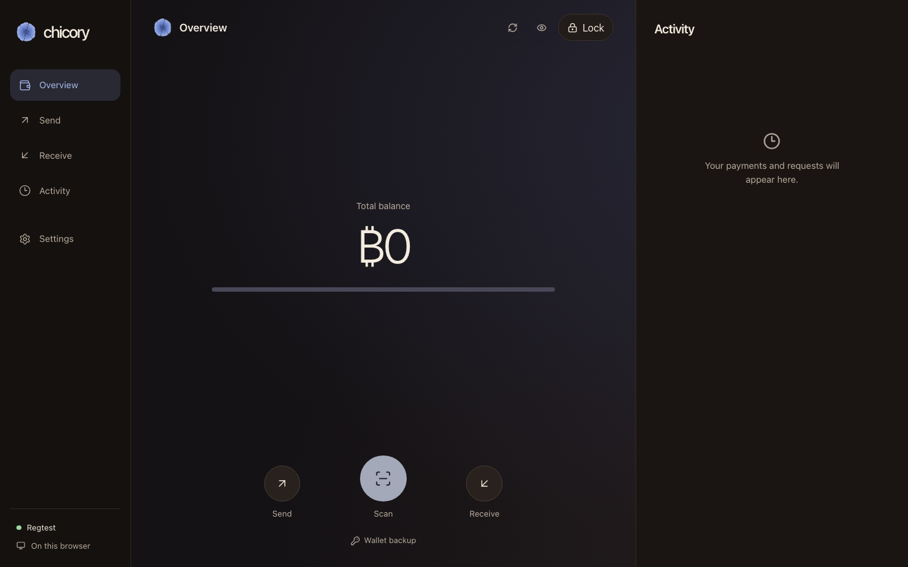

# Chicory Web

Chicory is a Bitcoin and Lightning wallet that runs in your browser. The desktop layout pairs the balance with an activity panel and a navigation rail. The compact layout keeps the balance and Send, Scan, and Receive together. Keys, the wallet database, and channel state live in an encrypted browser vault.



[View the compact wallet layout](docs/screenshots/mobile.png)

## Open a wallet

| How you start | How you unlock this browser | How you move or recover the wallet |
| --- | --- | --- |
| **Continue with Pubky Ring**, then create with Ring | Set up Ring unlock, or choose a local password. A password-backed vault can enable Ring unlock later and keep its password. | For a Ring-backed wallet, use the verified device transfer. Back up the Pubky identity in Ring. |
| **Use a password** | Enter the password for this browser. No Pubky account is required. | Save the recovery phrase. It restores the Bitcoin keys. Recovering open Lightning channels also needs current channel data from the recovery peer. |

Choose the Ring path if you want device transfers. Choosing **Create with recovery phrase** creates independently generated Bitcoin keys, even when signed in to Pubky. Enabling Ring for local unlock and deriving Bitcoin keys from Ring are separate choices.

The ordinary Pubky sign-in grants access to this account's private wallet files. Creating a Ring-backed wallet requires separate approvals for the local vault and Bitcoin keys. Each later Ring unlock requests the permission specific to that browser. An exclusive local file handle prevents two tabs from operating one vault. A Ring-backed wallet also holds an exclusive homeserver lease. Refreshing, closing the tab, or switching accounts locks the wallet.

### Move a Ring-backed wallet

1. Open **Settings** on the current device and select **Move to another device**. Approve in Ring and keep the wallet open until **Ready on your other device** appears.
2. Open Chicory Web on the destination, connect the same Pubky identity on the same Bitcoin network, and choose a local unlock method. Select **Use wallet on this device** and approve in Ring.
3. Unlock on the destination. It verifies and saves the encrypted transfer before claiming ownership. The source can reclaim an unclaimed transfer using **Keep wallet here**.

Moving from the [original Pubky web wallet](https://github.com/pubky/pubky-app/tree/6ff7ac9a9c2769e3022a5d2357abe75692fc5cc6) uses the same procedure. A different site origin gets a separate local vault, even on the same computer. Keep the original site's data until the destination opens successfully. Pending sends or unverified channels can delay a move. If the old device is gone, peer recovery can leave channels on hold until their state is verified.

## Run locally

Use Node.js 24, npm, and a browser with Origin Private File System support. The example uses **Bitcoin mainnet** and the same public Iroh primary as Chicory mobile. For development with test coins, set the three regtest values below before starting the servers.

```sh
git clone https://github.com/coreyphillips/chicory-web.git
cd chicory-web
npm ci
cp .env.example .env.local
openssl rand -hex 32 | sed 's/^/WALLET_RELAY_SECRET=/' >> .env.local
```

Start the WebSocket relay in one terminal and Next.js in another.

```sh
npm run relay
```

```sh
npm run dev -- -H 127.0.0.1
```

Open [the local wallet](http://127.0.0.1:3000). Use that same origin each time. The app and relay must agree on both origins and the relay secret.

For regtest, use your own Electrum server and reachable Lightning peer.

```dotenv
WALLET_NETWORK=regtest
WALLET_PRIMARY_URI=<your-peer-public-key>@127.0.0.1:9735
WALLET_ELECTRUM=tcp://127.0.0.1:60001
```

## Send and receive

Scan or enter a Lightning invoice, Bitcoin address, BIP21 request, or Pubky ID. Review the amount, destination, and fees before confirming. Receive can generate an on-chain address or a Lightning request. A first Lightning receive may require a liquidity quote from the configured primary. Where the primary and channel support offline receiving, you can create a fixed-amount offline invoice and check the verified receipt on return.

## Hosting

Serve the app from a stable HTTPS origin. Build with `npm ci && npm run build`, then run `npm start`. The browser worker and SQLite WASM are bundled automatically. A Node relay connects the worker's WebSockets to the two fixed upstreams. For self-hosting, run `npm run relay` with `.env.local`, terminate TLS at your reverse proxy, and forward WebSocket upgrades for `/peer` and `/electrum` to its loopback port. The relay can observe Electrum queries and network metadata.

| Setting | Purpose |
| --- | --- |
| `WALLET_NETWORK` | `mainnet`, `testnet`, or `regtest` |
| `WALLET_PRIMARY_URI` | Lightning public key and TCP address or Chicory Iroh link |
| `WALLET_ELECTRUM` | Fixed `tls://host:port` or `tcp://host:port` |
| `WALLET_APP_ORIGIN` | Exact browser origin. Use HTTPS outside loopback. |
| `WALLET_RELAY_ORIGIN` | Browser-facing relay origin. Use WSS outside loopback. |
| `WALLET_RELAY_SECRET` | A private 32-byte hex key shared by the self-hosted app server and relay |
| `WALLET_RELAY_PORT` | Optional loopback relay port, default `8790` |
| `WALLET_PEER_TUNNEL` | Optional fixed TCP forward to the configured peer |
| `NEXT_PUBLIC_PUBKY_HTTP_RELAY` | Optional Ring approval relay, configured at build time. Defaults to the Pubky staging HTTP relay used by the original wallet. |

On Vercel, set the app and relay origins to the same deployment domain with HTTPS and WSS respectively. The included Node routes handle upgrades and use the regional Runtime Cache for short-lived tickets. Self-hosted installations use the shared secret. Configure the reverse proxy to limit concurrent connections and request rates for a public relay. GitHub Pages can host static files only. This app needs a server for connection grants and a WebSocket relay for payments.

## Verify

```sh
npm run typecheck
npm test
npm run build
```

For a browser worker test, run a reachable local regtest peer and Electrum, install Chromium with `npx playwright install chromium`, then run the command below. It creates an unfunded wallet in a disposable browser profile and checks password reopening, exclusive access, and recovery after interruption.

```sh
WALLET_SMOKE_PRIMARY='<peer-public-key>@127.0.0.1:9735' \
WALLET_SMOKE_ELECTRUM_PORT=60001 npm run test:wallet:browser
```

## Sources

The wallet worker, payment and receipt flows, Ring approvals, and device handoff come from the [Pubky wallet integration](https://github.com/pubky/pubky-app/tree/6ff7ac9a9c2769e3022a5d2357abe75692fc5cc6). The interface and branding follow [Chicory mobile](https://github.com/coreyphillips/chicory) and [Chicory desktop](https://github.com/coreyphillips/chicory-desktop). The embedded Beignet 0.43.6 engine and build provenance are documented in the [vendor notes](vendor/README.md). See the [MIT license](LICENSE).
